<div align="center">


# Tether

**Learning that doesn't drift.**

An offline study app that shows students two scores, **with help** and **alone**, and then closes the gap between them.

[**Try it live**](https://tether-4cg.pages.dev) · [**Figma design**](https://www.figma.com/design/Grz4NIO1NyY1ziciaDn32y) · [Spec](docs/spec.md) · [Roadmap](docs/roadmap.md)

    

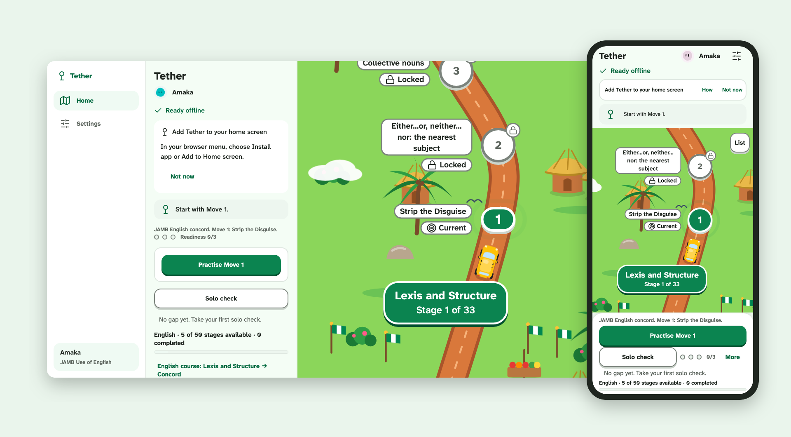

</div>

## The problem

Students practise with the answer close by, so they feel ready. Then they sit the exam alone, and the help isn't there. Nobody shows them that gap until the exam does.

Tether makes the gap visible early and works on it every day. It is built for learners across Africa on cheap phones and patchy data. JAMB Use of English is the **first content pack**. The app itself works for any subject or exam.

## How it works

| | Step | What happens |
|---|---|---|
| 1 | **Learn the move** | A short animated lesson teaches one exam pattern, such as *Strip the Disguise* for subject–verb concord. |
| 2 | **Practise with help** | Rounds of 5 questions. A help ladder (Nudge → Show me → Go deeper) is always one tap away. |
| 3 | **Earn readiness** | After each unaided correct answer, Tether asks *How did you know?* Only "I used the move" earns a readiness dot. |
| 4 | **Prove it alone** | A 10-question solo check with no help. Pass and the move is **Proved**. |
| 5 | **Recheck on day 3, 7 and 14** | Short rechecks confirm the skill **Held**. If one slips, the move turns **Fading** and recovery is offered. |

Every result shows both numbers side by side, so the learner sees the gap and watches it close.

## Screenshots

Taken from the live app with demo data (learner "Amaka").

### Phone

<table>
  <tr>
    <td align="center">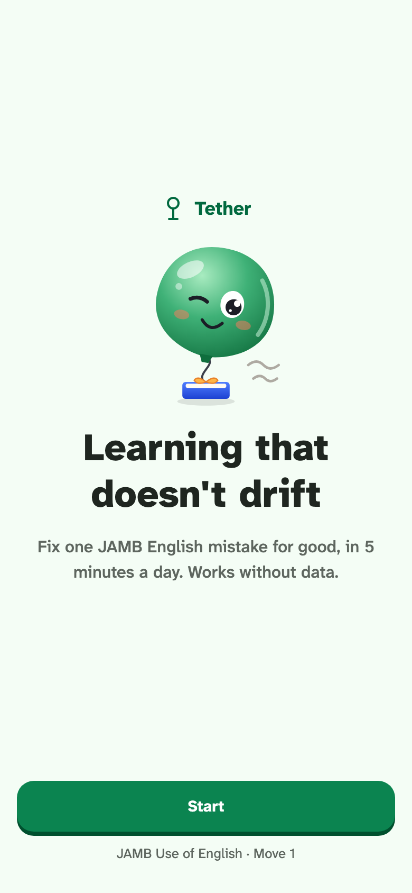<br><sub>Welcome</sub></td>
    <td align="center">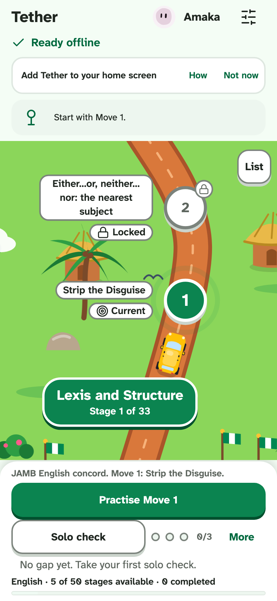<br><sub>Journey map</sub></td>
    <td align="center">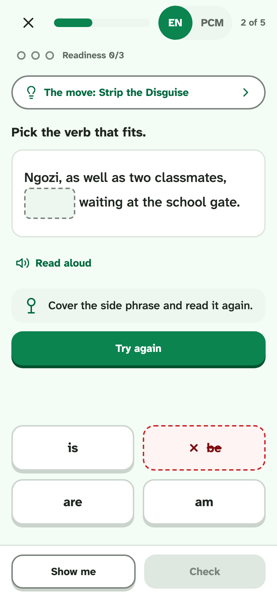<br><sub>Practice with a nudge</sub></td>
  </tr>
  <tr>
    <td align="center">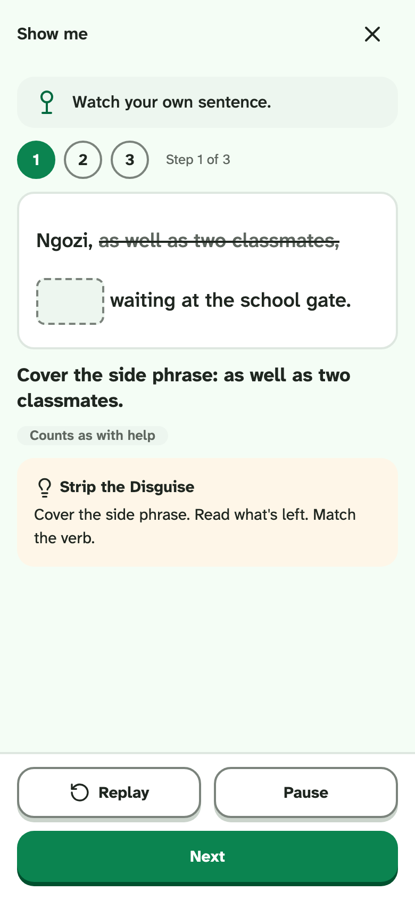<br><sub>Show me, step by step</sub></td>
    <td align="center">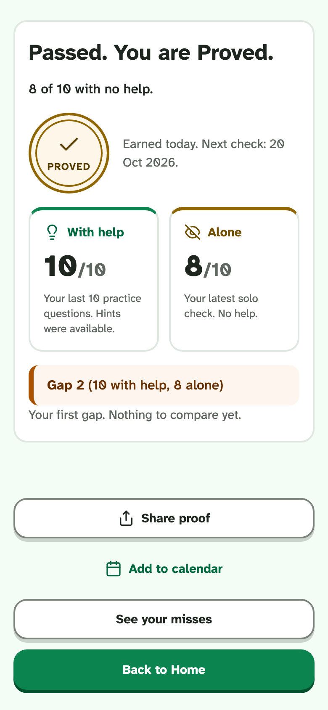<br><sub>With help vs alone</sub></td>
    <td align="center">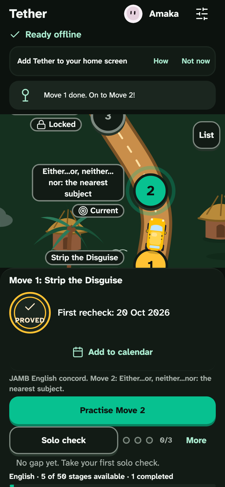<br><sub>Dark theme (Forest Night)</sub></td>
  </tr>
</table>

### Desktop

<table>
  <tr>
    <td align="center">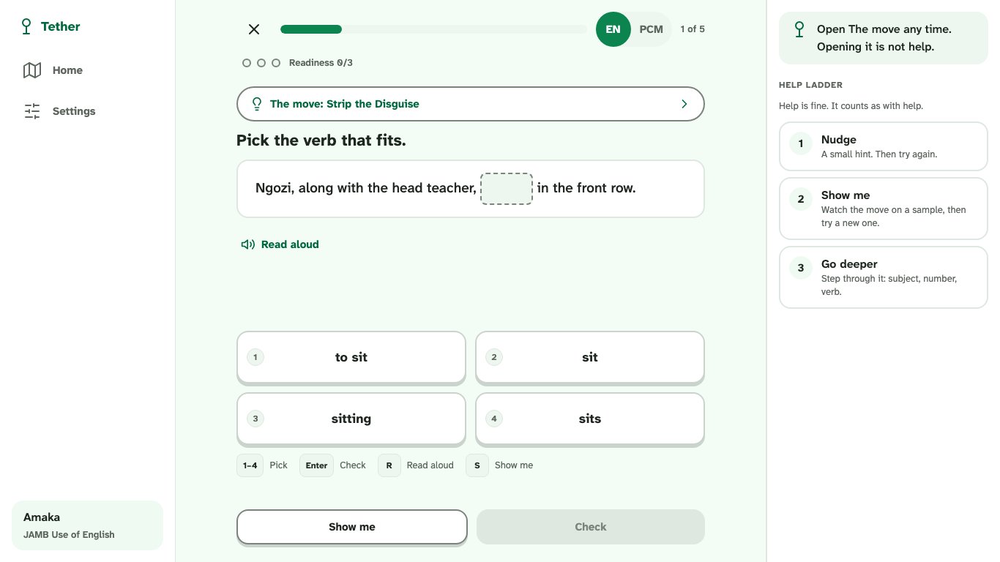<br><sub>Practice with the help ladder</sub></td>
    <td align="center">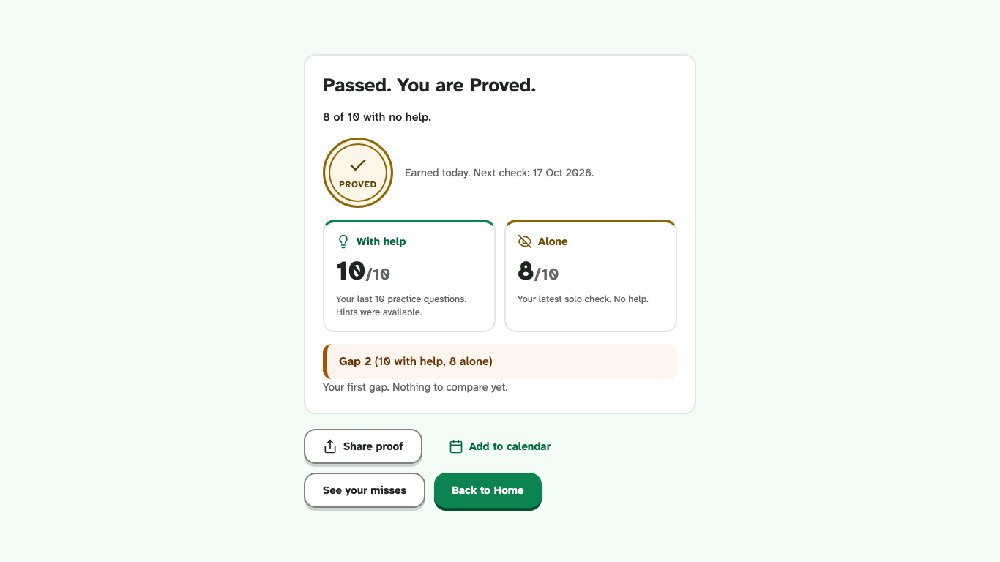<br><sub>Solo check result: Proved</sub></td>
  </tr>
  <tr>
    <td align="center">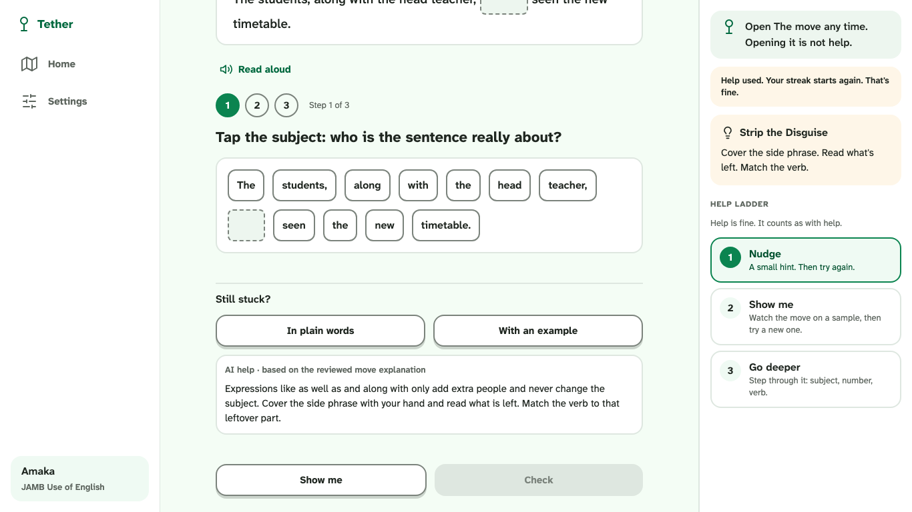<br><sub>"Still stuck?" AI help</sub></td>
    <td align="center">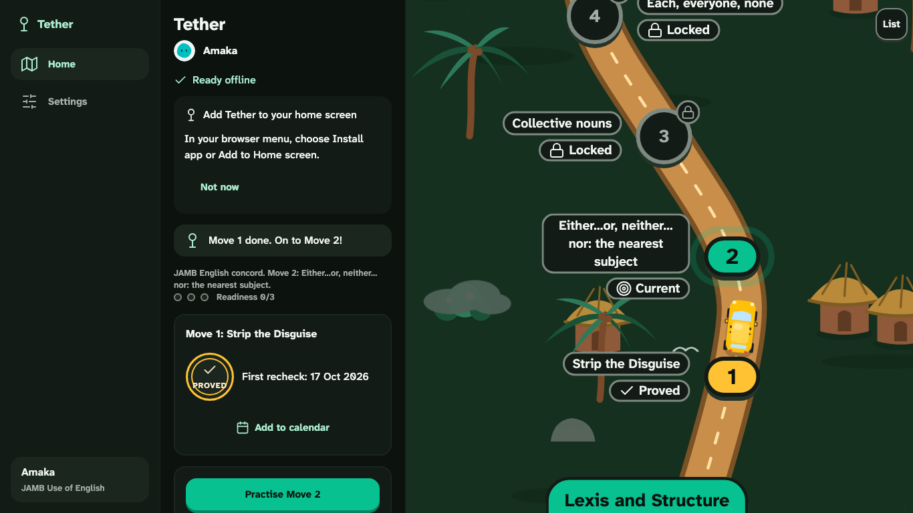<br><sub>Journey map, dark theme</sub></td>
  </tr>
</table>

## Features

- **Works offline.** Installable PWA with all progress stored on the device (IndexedDB). No account needed.
- **Journey map.** A game-style road through 50 English stages, with a danfo bus that drives to the next stage. Stages unlock in order.
- **Two scores, always.** *With help* and *alone* sit side by side on every result.
- **Honest readiness.** Readiness dots come from using the move. Guessing is fine, and Tether never accuses anyone of lying.
- **Spaced rechecks.** Day 3, 7 and 14, with *Add to calendar* and a recovery path when a move fades.
- **Coach Bo.** A friendly balloon mascot, or text only. Coach text in English or Pidgin, with read-aloud.
- **Share a win.** Proof cards of wins, shared only when the learner chooses. Failures are never shared.
- **"Still stuck?" AI help** (optional, online). Explains the move in plain words or with an example. AI never grades: human-reviewed rules generate and mark every answer.
- **Light and dark themes**, sounds you can turn off, and accessibility checks in the test suite.

## Status

| | |
|---|---|
| **Live** | [tether-4cg.pages.dev](https://tether-4cg.pages.dev) |
| **Content** | JAMB Use of English, concord: 5 of 50 stages playable |
| **Reviewed** | Move 1 is human-reviewed. Moves 2–5 are rule-generated and waiting for review ([checklist](docs/content/moves-2-5-review.md)) |
| **Next** | More English stages, then more subjects and exams (WASSCE, KCSE) as content packs |

## Design

The full design lives in Figma: **[Tether – Design](https://www.figma.com/design/Grz4NIO1NyY1ziciaDn32y)**. It holds the design system, the screens and both themes.

Colours, type and spacing come from one token source. `tools/tokens/tokens.py` generates them, with WCAG contrast checks, and `npm run tokens` rebuilds the CSS.

## Tech stack

| Layer | Choice |
|---|---|
| UI | [Preact](https://preactjs.com) + TypeScript, routed with `preact-iso` |
| Build | [Vite](https://vite.dev) |
| Storage | IndexedDB via `idb-keyval`, with a service worker for offline use |
| Motion | CSS and the Web Animations API (no animation libraries, to keep downloads small) |
| AI help | A Cloudflare Pages Function calling [OpenRouter](https://openrouter.ai). The key stays server-side |
| Tests | [Vitest](https://vitest.dev) unit tests, [Playwright](https://playwright.dev) end-to-end tests with axe accessibility checks |
| Hosting | Cloudflare Pages |

## Getting started

```bash
npm install
npm run dev          # local dev server
npm run build        # typecheck + production build into dist/
npm run preview      # serve dist/ at http://localhost:4173
```

### Tests

```bash
npm test                          # unit tests (Vitest)
npx playwright install chromium   # once
npm run test:e2e                  # browser tests against the preview build
npm run screens                   # screenshots of every screen into screenshots/
```

### Online AI help (optional)

The app works fully without it. To run *Still stuck?* locally:

```bash
cp .dev.vars.example .dev.vars        # gitignored; set OPENROUTER_API_KEY (and optionally AI_MODEL)
npm run build
npx wrangler@4.150.0 pages dev dist   # app + /api/explain locally
node tools/ai-sample.ts               # 20 live samples into docs/ai-review.md for human review
```

### Deploy

```bash
npx wrangler@4.150.0 login
npx wrangler@4.150.0 pages secret put OPENROUTER_API_KEY --project-name tether   # once
npm run build
npx wrangler@4.150.0 pages deploy dist --project-name tether --branch main
DEPLOY_URL=https://tether-4cg.pages.dev npx playwright test -c playwright.deployed.config.ts
```

Before a release, follow [`docs/release-checks.md`](docs/release-checks.md).

## Project structure

```
src/
  content/     question packs, the 50-stage course blueprint and the lessons
  rules/       practice, readiness, solo runs, gap and proof/recheck logic
  storage/     IndexedDB records
  ui/          screens: onboarding, learn, practice, help, solo, results, home map, share, settings
  sw.js        service worker (offline)
functions/     Cloudflare Pages Function for /api/explain
server/        shared AI explanation core
tools/         design tokens, icons, question lists, AI sampling
e2e/           Playwright tests (e2e-deployed/ runs against the live site)
docs/          spec, roadmap, decisions, course journey, content reviews
```

## Docs

- [`docs/spec.md`](docs/spec.md): the build contract (start here)
- [`docs/roadmap.md`](docs/roadmap.md): build order and completion checks
- [`docs/course-journey.md`](docs/course-journey.md): syllabus, stages and Learn pages
- [`docs/decisions.md`](docs/decisions.md): why things are the way they are
- [`docs/CAPSTONE-PITCH.md`](docs/CAPSTONE-PITCH.md): the capstone pitch
- [`AGENTS.md`](AGENTS.md): rules for coding agents working in this repo

## Credits

Bundled third-party code and font licences are listed in [`THIRD_PARTY_NOTICES.md`](THIRD_PARTY_NOTICES.md).
